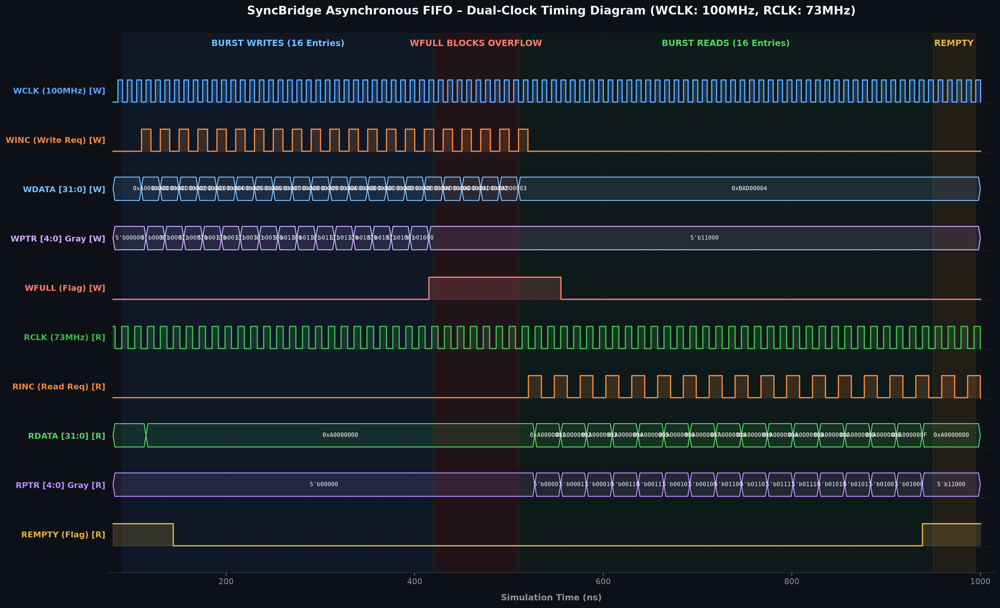

# SyncBridge – Dual-Clock Asynchronous FIFO

[](#architecture-overview)
[](https://steveicarus.github.io/iverilog/)
[-success.svg)](#regression-results)
[](#clock-domain-crossing-cdc--gray-code-theory)

A synthesizable, parameterized dual-clock **Asynchronous FIFO (First-In, First-Out)** implemented in **SystemVerilog**, designed for high-throughput networking ASIC pipelines and Clock Domain Crossing (CDC) interconnects. The design implements Clifford E. Cummings' seminal dual-clock architecture featuring multi-stage Gray-code synchronizers, zero-latency pessimistic full/empty status flags, and a self-checking verification suite with automated multi-seed Python regression testing.

---

## Architecture Overview

```
                            CLOCK DOMAIN CROSSING (CDC) BOUNDARY
                                             :
       ================= WRITE CLOCK DOMAIN  :  READ CLOCK DOMAIN =================
                        (wclk = 100 MHz)     :  (rclk = 73 MHz)
                                             :
        +-----------+                        :                         +-----------+
winc -->|           |                        :                         |           |--> rempty
wdata-->|  fifomem  |------------------------:------------------------>|  rdata    |
        |  (DP-RAM) |   [mem array: 2^ADDR_WIDTH x DATA_WIDTH]         |           |
        |           |<-----------------------:-------------------------|           |<-- rinc
        +-----------+                        :                         +-----------+
          ^       ^                          :                           ^       ^
          |waddr  |!wfull                    :                           |raddr  |!rempty
          |       |                          :                           |       |
     +---------+  |                          :                      +---------+  |
     |wptr_full|--+                          :                      |rptr_empty|-+
     +---------+                             :                      +---------+
       |     ^                               :                        |     ^
  wptr |     | wq2_rptr                      :                   rptr |     | rq2_wptr
[Gray] |     +-----------------------+       :       +----------------+     | [Gray]
       |                             |       :       |                      |
       v                             |       :       v                      |
   +-------+                     +-------+   :   +-------+              +-------+
   |  CDC  |-------------------->|2-FF D |   :   |  CDC  |------------->|2-FF D |
   |Channel|                     |Sync   |   :   |Channel|              |Sync   |
   +-------+                     |(wclk) |   :   +-------+              |(rclk) |
                                 +-------+   :                          +-------+
                                 sync_r2w    :                          sync_w2r
                                             :
```

### Key Hardware Specifications
- **Parameterized Geometry**: Configurable word width (`DATA_WIDTH`, default 32) and depth address width (`ADDR_WIDTH`, default 4 $\rightarrow$ Depth = 16 words).
- **Safe Clock Domain Crossing (CDC)**: Read and write pointers are converted to Gray code before crossing clock domains; multi-bit transition skew cannot produce invalid intermediate states.
- **2-Stage Flip-Flop Synchronizers**: Dedicated modules (`sync_r2w.sv`, `sync_w2r.sv`) with active-low asynchronous resets (`wrst_n`, `rrst_n`) providing MTBF exceeding thousands of operational years.
- **Pessimistic Flag Generation**: Zero-latency registered full (`wfull`) and empty (`rempty`) flags guarantee data integrity:
  * Full assertion is conservative: the read pointer may have advanced in the read domain, meaning the FIFO may not be completely full, but it will **never overflow**.
  * Empty assertion is conservative: the write pointer may have advanced in the write domain, meaning the FIFO may contain newly arrived data, but it will **never underflow**.

---

## Simulation & Waveforms

The timing diagram below demonstrates a complete operational cycle: bursting 16 transactions into the FIFO until `wfull` asserts, verifying that overflow write attempts are safely rejected, followed by consecutive reads until `rempty` asserts and underflow reads are rejected.



---

## Directory Structure

```
async-fifo-sv/
├── rtl/                        # Synthesizable SystemVerilog RTL modules
│   ├── fifomem.sv              # Dual-port parameterized memory array
│   ├── sync_r2w.sv             # 2-FF Gray read pointer synchronizer (wclk domain)
│   ├── sync_w2r.sv             # 2-FF Gray write pointer synchronizer (rclk domain)
│   ├── wptr_full.sv            # Write pointer logic & Cummings wfull generation
│   ├── rptr_empty.sv           # Read pointer logic & rempty generation
│   └── async_fifo.sv           # Top-level wrapper module
├── tb/                         # Layered Verification Environment
│   └── tb_async_fifo.sv        # Self-checking testbench with dual clocks & scoreboard
├── docs/                       # Documentation assets
│   └── waveform.png            # High-resolution simulation timing diagram
├── sim/                        # Simulation workspace
│   └── .gitkeep                # Git tracking placeholder
├── scripts/                    # Automation & Regression
│   ├── run_regression.py       # Automated regression runner across tests & seeds
│   └── generate_waveform_plot.py # Waveform plotting utility
├── .gitignore                  # Git ignore rules for simulation artifacts
└── README.md                   # Project documentation
```

---

## Clock Domain Crossing (CDC) & Gray Code Theory

### 1. Why Gray Code?
In an asynchronous FIFO, pointers must cross between unsynchronized clock domains. If standard binary counters are synchronized directly across domains (e.g., transitioning from `0111` to `1000`), multiple bits toggle simultaneously. Due to physical routing skews and wire delays, destination synchronizers may sample an intermediate state (e.g., `0000` or `1111`), causing catastrophic data corruption or false flag assertions.

Gray codes guarantee that **exactly one bit changes per counter increment**:
$$d_H\big(G(k),\, G(k+1)\big) = 1 \quad \forall k$$

If an asynchronous clock edge arrives precisely during a Gray pointer bit transition, at most one bit can be metastable; the sampled value will resolve to either the old valid value or the new valid value, never an arbitrary corrupted address.

### 2. Why Power-of-2 Depth?
An $N$-bit Gray code sequence is naturally cyclic only when the sequence length is an exact power of 2 ($2^N$). If an arbitrary non-power-of-2 depth (such as 10) is used, wrapping around from the last address back to 0 requires multiple bits to toggle simultaneously, destroying the Gray code single-bit invariant. Hence, dual-clock Gray-code FIFOs require $2^N$ depth.

### 3. Pointer Width & Disambiguation (`ADDR_WIDTH + 1`)
To differentiate between a **FIFO FULL** condition and a **FIFO EMPTY** condition when both read and write addresses point to the same memory slot:
- Pointer registers are sized to `ADDR_WIDTH + 1` bits (e.g., 5 bits for a 16-entry FIFO).
- The lower `ADDR_WIDTH` bits directly index the memory array (`mem[ADDR_WIDTH-1:0]`).
- The most significant bit (MSB) acts as a wrap-around / phase indicator.

### 4. Mathematical Full and Empty Conditions

#### Empty Condition:
The FIFO is empty when the next read Gray pointer equals the synchronized write Gray pointer:
$$\text{rempty\_val} = (\text{rgraynext} == \text{rq2\_wptr})$$

#### Full Condition (Clifford Cummings Equation):
The FIFO is full when the write pointer has wrapped around exactly once more than the read pointer, pointing to the same memory index:
1. The **MSB** is inverted ($\text{MSB}_w \neq \text{MSB}_r$).
2. The **2nd MSB** is inverted ($\text{MSB-1}_w \neq \text{MSB-1}_r$).
3. All remaining **LSBs** match ($\text{LSBs}_w == \text{LSBs}_r$).

$$\text{wfull\_val} = (\text{wgraynext} == \{\sim\text{wq2\_rptr}[A:A-1],\, \text{wq2\_rptr}[A-2:0]\})$$

---

## Layered Verification Environment

The testbench (`tb/tb_async_fifo.sv`) implements an industrial-grade, self-checking verification environment:

1. **True Asynchronous Clocking**:
   - `wclk`: 100 MHz ($T = 10.000\text{ ns}$, half-cycle = 5,000 ps).
   - `rclk`: 73 MHz ($T \approx 13.698\text{ ns}$, half-cycle = 6,849 ps).
   - The incommensurable clock frequency ratio forces continuous phase precession, edge collisions, and race hazards across the synchronizers.

2. **Golden Reference Scoreboard**:
   - Dynamically queues transaction payloads on valid writes (`winc && !wfull`).
   - Automatically pops and strictly compares expected vs actual data on valid reads (`rinc && !rempty`).
   - Instant `$fatal` trigger on payload corruption, bit inversion, or order distortion.

3. **Protocol & Invariant Safety Checkers**:
   - **Gray Code Single-Bit Invariant**: Computes Hamming distance between consecutive pointer states on every clock cycle; asserts error if distance $> 1$.
   - **Overflow Protection Invariant**: Monitors `wfull && winc`; asserts error if `wbin` increments or memory contents at `waddr` are modified while full.
   - **Underflow Protection Invariant**: Monitors `rempty && rinc`; asserts error if `rbin` increments while empty.

---

## Regression Results

Automated regression execution via `python3 scripts/run_regression.py`:

```
================================================================================
                           REGRESSION RESULTS SUMMARY                        
================================================================================

#   | Test Name          | Type       | Seed  | Writes  | Reads   | Assertions  | Time    | Status
--------------------------------------------------------------------------------------------------
1   | TEST_FULL_EMPTY    | Directed   | -     | 16      | 16      | 192         | 0.12  s | PASS
2   | TEST_FAST_WRITE    | Directed   | -     | 80      | 80      | 608         | 0.16  s | PASS
3   | TEST_FAST_READ     | Directed   | -     | 80      | 80      | 594         | 0.16  s | PASS
4   | TEST_RANDOM_RESET  | Directed   | -     | 40      | 30      | 267         | 0.14  s | PASS
5   | TEST_RANDOM        | Randomized | 1     | 150     | 150     | 629         | 0.13  s | PASS
6   | TEST_RANDOM        | Randomized | 2     | 150     | 150     | 591         | 0.13  s | PASS
7   | TEST_RANDOM        | Randomized | 3     | 150     | 150     | 624         | 0.13  s | PASS
8   | TEST_RANDOM        | Randomized | 4     | 150     | 150     | 556         | 0.16  s | PASS
9   | TEST_RANDOM        | Randomized | 5     | 150     | 150     | 608         | 0.15  s | PASS
10  | TEST_RANDOM        | Randomized | 6     | 150     | 150     | 613         | 0.16  s | PASS
11  | TEST_RANDOM        | Randomized | 7     | 150     | 150     | 582         | 0.13  s | PASS
12  | TEST_RANDOM        | Randomized | 8     | 150     | 150     | 563         | 0.12  s | PASS
13  | TEST_RANDOM        | Randomized | 9     | 150     | 150     | 639         | 0.13  s | PASS
14  | TEST_RANDOM        | Randomized | 10    | 150     | 150     | 568         | 0.14  s | PASS
--------------------------------------------------------------------------------------------------
TOT | 14 Tests           | All        | -     | 1716    | 1706    | 7634        | 2.01  s | 100% PASS
--------------------------------------------------------------------------------------------------
```

---

## Quickstart & Simulation

### Prerequisites
- [Icarus Verilog](http://iverilog.icarus.com/) (`iverilog`, `vvp` v11.0+)
- Python 3.8+
- [GTKWave](http://gtkwave.sourceforge.net/) (optional, for viewing waveform dumps)

### 1. Run Complete Automated Regression
```bash
python3 scripts/run_regression.py
# On Windows environments:
python scripts/run_regression.py
```

### 2. Manual Compile and Run Single Test
```bash
# Compile design and testbench
iverilog -g2012 -Wall -s tb_async_fifo -o sim/sim_tb.vvp rtl/*.sv tb/tb_async_fifo.sv

# Run directed corner-case test
vvp sim/sim_tb.vvp +TESTNAME=TEST_FULL_EMPTY

# Run backpressure write burst test
vvp sim/sim_tb.vvp +TESTNAME=TEST_FAST_WRITE

# Run underflow read test
vvp sim/sim_tb.vvp +TESTNAME=TEST_FAST_READ

# Run asynchronous reset injection test
vvp sim/sim_tb.vvp +TESTNAME=TEST_RANDOM_RESET

# Run randomized test with seed
vvp sim/sim_tb.vvp +TESTNAME=TEST_RANDOM +SEED=42
```

### 3. Inspect Waveforms
Generate waveform traces (`sim/waves.vcd`) during simulation and open in GTKWave:
```bash
gtkwave sim/waves.vcd
```
